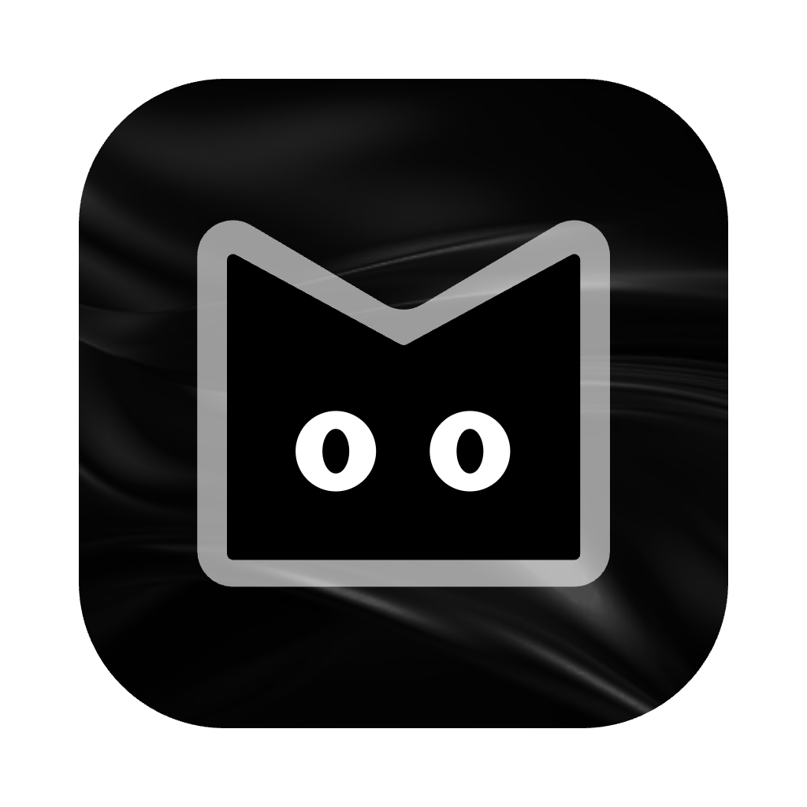

<div align="center">



# Frodon

**A desktop IDE for people who'd rather not switch windows.**

Editor, terminals, git, a browser and a whiteboard — tiled side by side in one
window, colored by the project you're in.

[Install](#install) · [Features](#what-it-does) · [Shortcuts](#shortcuts) ·
[Build from source](#build-from-source) · [Docs](docs/README.md)


</div>

---

Most of a working day is spent moving between an editor, a terminal, a git
client and a browser, and losing your place each time. Frodon puts them in one
window as tiles you split and arrange yourself, remembers that arrangement per
project, and gives every project its own color so you can tell at a glance
which one you are in.

It is built for one person's own workflow and shared in case it suits yours.
There is nothing to buy, and decisions are made to fit how it is actually
used — which also means it is early, opinionated, and honest about what is
missing.

## What it does

**A workbench of tiles.** Split right, split down, and put an editor, a
terminal, the repository, a board or a web page in each. The layout is saved
per project and comes back the way you left it.

**An editor.** CodeMirror 6 with syntax highlighting for every language it
ships, find-in-file, a star on tabs with unsaved changes, and tabs that follow
their files when something outside Frodon — an agent, a `git pull` —
rewrites them.

**Real terminals.** Real shells on real PTYs, as many as you want, each in its
own tile. Closing one kills its whole process tree, dev servers included.

**Git, built in.** Pull, push and switch branches from the header. Changed
files colored in the tree, a history graph, branches with ahead/behind counts,
a staging area with diffs, and what any commit did.

**Worktrees.** Open two branches of one repository side by side, each in its
own window, without stashing anything.

**Find everything.** A file picker on <kbd>⌘P</kbd> that ranks the whole
project as you type, and project-wide search with find and replace.

**A browser in a tile.** Tabs that can be pinned to a phone or tablet width,
so a layout can be checked at a size the pane isn't, and bookmarks in groups
— kept with the project or privately.

**Boards.** A drawing surface for shapes, arrows, pen strokes and text, saved
into the project or into your home directory.

**Projects with an identity.** Every project gets a name, an icon and a hue.
The focus ring, the cursor and the selected row are all that hue, and the Dock
icon can wear it too — so with three projects open, you always know which
window is which.

**Several windows.** One project per window, as many as you like, and a
launcher with the last five you opened.

**Updates itself.** When a new version is out, a _Restart to update_ button
appears in the header. One click, and Frodon reopens on the projects you had
open.

## Install

Frodon runs on macOS, on Apple Silicon and Intel.

1. Download the latest `Frodon-<version>-arm64.dmg` from
   [Releases](https://github.com/edouardjamieson/frodon-ide/releases/latest) —
   or `-x64.dmg` on an Intel Mac.
2. Drag **Frodon** into **Applications**.
3. Frodon is not signed with an Apple Developer certificate, so macOS will call
   it damaged until you clear its quarantine flag. Once:

   ```bash
   xattr -dr com.apple.quarantine /Applications/Frodon.app
   ```

That is the only manual step. Updates after that arrive on their own.

## Shortcuts

`⌘` on macOS, `Ctrl` elsewhere.

| Shortcut | Does |
| --- | --- |
| <kbd>⌘P</kbd> | Open a file by name |
| <kbd>⌘S</kbd> | Save |
| <kbd>⌘F</kbd> | Find in the file |
| <kbd>⌘W</kbd> | Close the tab |
| <kbd>⌘B</kbd> | Show or hide the sidebar |
| <kbd>⇧⌘E</kbd> · <kbd>⇧⌘F</kbd> · <kbd>⇧⌘B</kbd> · <kbd>⇧⌘W</kbd> | Explorer · Search · Boards · Worktrees |
| <kbd>⇧⌘G</kbd> | Open the repository |
| <kbd>⇧⌘→</kbd> · <kbd>⇧⌘↓</kbd> | Split right · Split down |
| <kbd>⇧⌘N</kbd> | New window |
| <kbd>⌘,</kbd> | Settings |

## Build from source

You need Node 22 or later and pnpm. `corepack enable` picks up the version
pinned in `package.json`.

```bash
git clone https://github.com/edouardjamieson/frodon-ide.git
cd frodon-ide
pnpm install
pnpm dev
```

| Command | Does |
| --- | --- |
| `pnpm dev` | Run with hot reload in the renderer |
| `pnpm run typecheck` | Check both halves — the check that matters, since there are no tests yet |
| `pnpm run lint` | ESLint |
| `pnpm dist` | Package `Frodon.app` into `dist/`, as a dmg and a zip for both arches |
| `pnpm release` | Bump the version, tag it and push; CI builds and publishes the release |

If `pnpm dev` fails with `Error: Electron uninstall`, the Electron binary was
not downloaded — run `pnpm exec install-electron`.

## How it's built

Electron 44 · React 19 · TypeScript · CodeMirror 6 · xterm.js on node-pty ·
zustand · Tailwind 4 · electron-vite.

The main process owns every fact — the filesystem, the watcher, git, the
shells — and the renderer is a sandboxed page that draws views of them and
cannot read a file without asking. Everything that crosses between the two is
declared once, in `src/shared/ipc.def.ts`.

The documentation is written to be read, by people and by coding agents
alike. Start at [`docs/README.md`](docs/README.md):

| | |
| --- | --- |
| [architecture.md](docs/architecture.md) | the process split, state ownership, security |
| [ipc.md](docs/ipc.md) | how the two halves talk, and how to add a channel |
| [theme.md](docs/theme.md) | palette → roles → CSS variables, and why no theme has an accent |
| [features/](docs/features/) | one file per feature: the goal, the mechanism, the user flows, what's missing |
| [decisions.md](docs/decisions.md) | every architectural decision, and what it cost |
| [learned.md](docs/learned.md) | what the platform taught us the hard way |

[`CLAUDE.md`](CLAUDE.md) is the contract agents work under in this repository.

## Where it's going

LSP is next and is the reason this exists — Frodon began as a terminal IDE
built on OpenTUI, and LSP was the thing a terminal was never going to give it.
After that: a command palette, the rest of the config layering, and asking
before a tab with unsaved work is closed. The full roadmap, and what came over
from the terminal version, is in [`docs/migration.md`](docs/migration.md).

## License

MIT — see [`LICENSE`](LICENSE).
